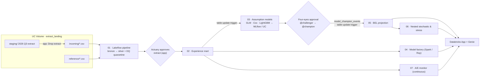

# Life & Pension Actuarial Workbench on Databricks

An end-to-end demo of **actuarial model development and workflow on Databricks** for a generic European life & pension insurer. A quarterly experience extract lands, is validated and approved, feeds an experience mart, re-estimates mortality/disability/lapse assumptions, goes through four-eyes approval, and automatically re-projects and stresses best-estimate liabilities. All of it is governed in Unity Catalog and driven by job triggers.

> **All data is synthetic.** The generator plants known "true" decrement rates, so you can show the GLMs recovering them. Numbers are illustrative only and are not a benchmark.

  

## What it shows

| # | App section | Databricks capability |
|---|---|---|
| – | Home | Platform overview, Databricks Apps |
| 1 | Data Ingestion | App-started job, Lakeflow Declarative Pipeline with data-quality expectations and quarantine, human-in-the-loop approval |
| 2 | Experience Mart | Spark SQL on serverless, Delta versioning, table-update trigger |
| 3 | Assumption Models | statsmodels Poisson GLMs, lifelines Cox models, logistic GLM vs LightGBM, MLflow tracking, UC model registry (@champion / @challenger) |
| 4 | Model Factory | Thousands of segment GLMs plus bootstrap fanned out with Spark `applyInPandas`; Ray alternative |
| 5 | Deployment & Approval | Four-eyes approval, alias promotion, model-change event that triggers re-projection |
| 6 | Projection Engine | Vectorised NumPy cash-flow projection fanned out with `mapInPandas`; what-if runs |
| 7 | Stochastic & Stress | Nested Monte Carlo (TVOG on guarantees), Solvency II-shaped stresses |
| 8 | Model Governance | Append-only audit log, reproducibility (data version, code, model run, approver) |
| 9 | Actuarial AI | AI/BI Genie space with actuarial instructions and example SQL |
| 10 | Orchestration & Compute | Trigger catalogue (manual, app, schedule, table update, model update, continuous), compute choices, PoC framing |

## Architecture



## Repository layout

```
databricks.yml                 Asset Bundle (variables: catalog, schema, warehouse_id, app_name)
resources/                     Jobs 00-07 + 99, declarative pipeline, volumes, MLflow experiment, app
src/
  actuarial_lib/               Plain Python: GLM fitting, projection kernel, stochastic valuation
  notebooks/                   Job notebooks (00 setup … 07 A/E monitor) + common.py helpers
  pipeline/extract_pipeline.py Lakeflow declarative pipeline (bronze → silver, DQ expectations)
  app/                         Databricks App: FastAPI backend (server/) + React/Vite/Tailwind frontend
scripts/
  generate_data.py             Seeded synthetic book → data/*.csv
  bootstrap.sql / run_sql.py   Schema + governed tables (run before the first bundle deploy)
  upload_data.sh               Upload the CSVs into the landing volume
  create_genie_space.py        Idempotent Genie space provisioning
  deploy_app.sh                Build frontend, deploy, grant app permissions, start the app
  reset_demo.sh / .py          Restore the rehearsed start state before a demo
  q.py                         Quick SQL helper
docs/
  demo-script-20min.md         20-minute talk track (GO / DO / SAY / IF-ASKED)
  implementation-notes.md      Platform gotchas and design decisions
  illustrative/x_ray_spot.yml  Ray-on-spot job config (for classic-compute workspaces)
```

## Prerequisites

- A Databricks workspace with **Unity Catalog** and **serverless** jobs, pipelines and SQL, plus a catalog you can create a schema in
- A SQL warehouse ID (serverless recommended)
- [Databricks CLI](https://docs.databricks.com/dev-tools/cli/) v0.250+ authenticated with a profile (`databricks auth login --profile DEFAULT`)
- [uv](https://docs.astral.sh/uv/) (Python 3.11+) and Node.js 20+

## Deploy from scratch

```bash
export CATALOG=main SCHEMA=lp_actuarial WAREHOUSE_ID=<your-warehouse-id> DATABRICKS_CONFIG_PROFILE=DEFAULT
VARS="--var catalog=$CATALOG --var schema=$SCHEMA --var warehouse_id=$WAREHOUSE_ID"

# 1. Generate the synthetic book (~50 MB in data/, git-ignored)
uv run --with numpy --with pandas python scripts/generate_data.py

# 2. Schema + governed tables. Table-update triggers need their tables to exist before the jobs are created.
uv run --with databricks-sdk python scripts/run_sql.py scripts/bootstrap.sql $CATALOG $SCHEMA $WAREHOUSE_ID

# 3. Deploy jobs, pipeline, volumes, experiment and app resource
databricks bundle deploy $VARS

# 4. Upload the CSVs into the landing volume
./scripts/upload_data.sh

# 5. Build the data and models. Jobs 03 and 05 fire automatically through table-update triggers.
databricks bundle run setup $VARS
databricks bundle run extract_ingest $VARS      # baseline 2015-2025 (auto-approved as the onboarding load)
databricks bundle run experience_mart $VARS
databricks bundle run model_factory $VARS       # optional, for the Model Factory page
databricks bundle run stochastic_stress $VARS   # optional, for the Stochastic & Stress page

# 6. Build and start the app, apply its grants, and create/share the Genie space
./scripts/deploy_app.sh
```

`deploy_app.sh` prints the app URL. Open each page once to warm it.

### Before every demo

```bash
./scripts/reset_demo.sh      # ~5-10 min: champion v1 / challenger v2, no pending approvals, mart rebuilt
```

Then follow [`docs/demo-script-20min.md`](docs/demo-script-20min.md). Figures quoted in the script (A/E, AIC, speed-ups) are approximate, so check them against your own run.

### Cost hygiene

Apps don't auto-stop. Run `databricks apps stop lp-actuarial-workbench` after the demo. The nightly schedule (job 02) and the continuous A/E monitor (job 07) are deployed **paused**.

### Run the app locally

```bash
cd src/app/frontend && npm install && npm run build && cd ..
DATABRICKS_PROFILE=DEFAULT CATALOG_NAME=$CATALOG SCHEMA_NAME=$SCHEMA WAREHOUSE_ID=$WAREHOUSE_ID \
  uv run --with-requirements requirements.txt uvicorn app:app --port 8000
```

## Synthetic data

`scripts/generate_data.py` (seed `20261006`) writes 100,000 policies across five schemes (company pension, private pension, life annuity, disability cover, health cover), 2015–2025 policy-year experience, disability claims, a standard mortality table, 1,000 economic scenarios, and a 2026 Q1–Q3 extract with deliberately bad rows for the DQ gate. Amounts are in EUR. Planted truths include Gompertz mortality (age slope 0.092), a male relativity of 1.33, 1.5% p.a. improvement, a socio-economic gradient by salary band, and a non-linear lapse surface with a 2022 rate-regime shift.

## Notes

- Model-update triggers (`MODEL_ALIAS_SET`) and file-arrival triggers are included as commented config. The demo uses an equivalent table-update trigger and an app button instead. See [`docs/implementation-notes.md`](docs/implementation-notes.md).
- The Ray-on-spot job in `docs/illustrative/` needs classic compute and is not deployed by the bundle.

## Disclaimer

This is a demonstration asset, not production actuarial software. It uses synthetic data only and is provided as-is, with no warranty. Results aren't suitable for reserving, pricing or regulatory reporting.
